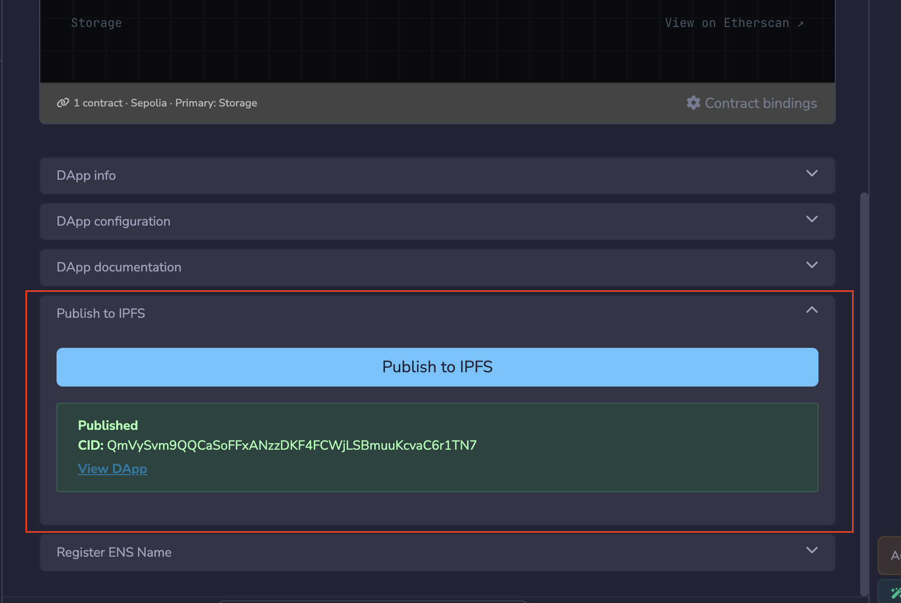
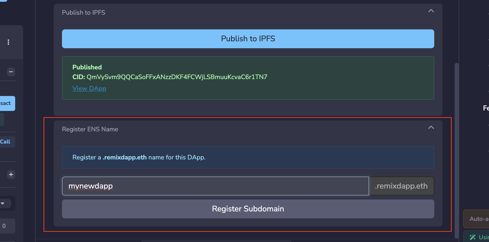

---
myst:
  html_meta:
    "description": "Deploy dApps generated by QuickDApp to IPFS and link them to an ENS subdomain directly from Remix IDE."
    "keywords": "deploy dapp, IPFS, ens, remixdapp.eth, quickdapp, remix ide"
---

# Deploying a dApp

```{warning}
This feature is only available to beta testers. Join the Remix beta program to get access.
```

You can deploy dApps generated by {doc}`QuickDApp </quickdapp>` on IPFS and link them to an ENS domain directly from Remix.

Remix automatically provides a free ENS subdomain under `remixdapp.eth` for
your dApp with no gas fees required.

## Deploying to IPFS

Before you deploy to IPFS, you must have a smart contract compiled and deployed using the Deploy & Run plugin, and a dApp generated by the QuickDApp plugin.

```{note}
When you are configuring rules for the dApp generation, ensure that you leave the "**Create as a Base mini-app**" checkbox under "**More options**" unchecked.
```

After QuickDApp generates your dApp, expand the "**Publish to IPFS**" tab below the dApp preview in the QuickDApp tab and click the "**Publish to IPFS**" button. You can also click "**Publish**" in the preview toolbar. This bundles and uploads your files to IPFS. Once the upload is complete, a `CID` (Content Identifier) is returned. This is a unique address that identifies your dApp on the network and is used as the target when registering the ENS subdomain.



## Register ENS subdomain

Once your dApp is on IPFS, you can link it to a human-readable ENS subdomain under `remixdapp.eth` (e.g. `myapp.remixdapp.eth`) so users can access it without needing the raw CID.

Registration transactions are processed on **Arbitrum One (L2)**, with gas fees covered by the Remix backend, so you pay nothing. To register the subdomain, expand the "**Register ENS Name**" tab below the dApp preview.

```{note}
This tab only becomes visible after the deployment to IPFS is complete.
```

Enter your preferred subdomain name (e.g., `bridge.remixdapp.eth`) and Remix will check its availability. Once you have selected an available subdomain, click the "**Register Subdomain**" button and wait for the server to process the registration.



```{note}
The returned URLs have `.limo` appended (e.g. `myapp.remixdapp.eth.limo`). This is because standard web browsers cannot natively resolve `.eth` domains. `.limo` is a gateway service that resolves ENS names and serves the underlying IPFS content over HTTPS.

```

Your dApp is now live at https://[yourname].remixdapp.eth.limo.

## Updating a published dApp

When you change a dApp after publishing it, for example with **Ask AI to Update**, QuickDApp marks it as **Published · Unpublished changes**. Your live site keeps showing the last published version until you publish again.

To publish your changes, click "**Publish changes**" in the preview toolbar, or "**Publish to IPFS**" in the "**Publish to IPFS**" tab. This uploads a new build and returns a new CID.

If your dApp already has an ENS subdomain, open the "**Register ENS Name**" tab and click "**Update Content Hash**" to point the subdomain at the new CID.
