---
myst:
  html_meta:
    "description": "QuickDApp is a Remix IDE feature that uses AI to generate React front-end interfaces for deployed Solidity contracts, supporting standard web dApps and Base mini apps."
    "keywords": "QuickDApp, Remix IDE, Solidity, dApp, AI-generated UI, React, Base mini app, smart contract, front-end"
---

# QuickDApp: Generating UIs for your Contracts

QuickDApp is a feature in Remix IDE that uses AI to generate front-end interfaces for your deployed Solidity contracts. Instead of manually building a UI, you can describe the dApp you want, optionally pointing QuickDApp at a Figma design, and it will generate a ready-to-use React application, either in its own workspace or alongside your contract. It supports both standard web dApps and Base mini apps.

## Creating a dApp

You can create a dApp with QuickDApp from:

1. A deployed contract in the Deploy and Run plugin
2. A `.subgraph` file or query
3. A ZK circuit or program, from Circom (`.circom`) or Noir

```{warning}
The dApps generated by QuickDApp are designed to work on public networks because it deploys the front end code to IPFS. Local networks like the Remix VM will have limited functionality.

```

### Creating a dApp from Deploy and Run

When you compile and deploy a Solidity contract using the Deploy and Run plugin, click the three dots next to the deployed contract and select **Create a DApp**.

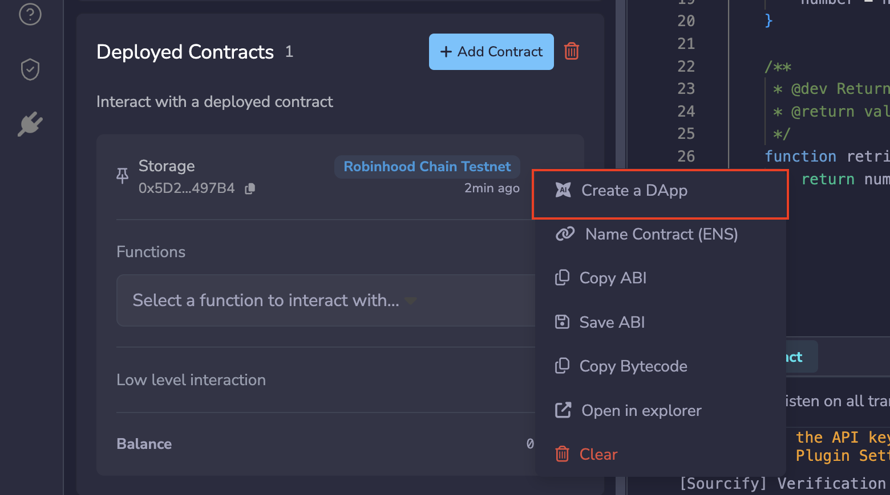

The **Create DApp** modal opens, where you configure the dApp before generation starts.

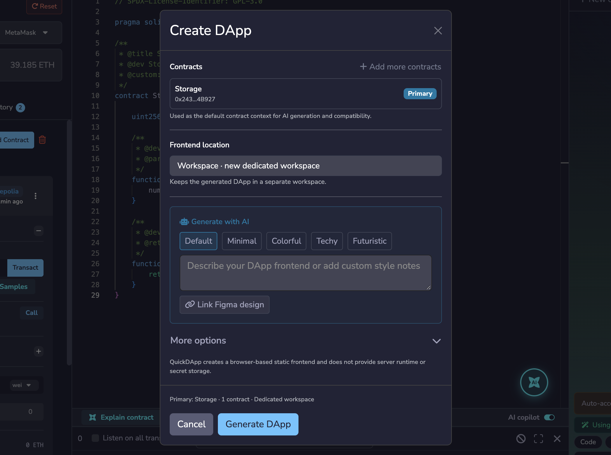

1. **Contracts**: The contract you clicked becomes the Primary Contract. Click **Add more contracts** to bind up to 7 more deployed contracts. See Using multiple contracts below.

2. **Frontend location**: Where QuickDApp puts the dApp's files.
   - **Workspace (new dedicated workspace)** creates a new workspace for the dApp and switches you to it. This keeps the dApp self-contained and easier to export, so use it when you are ready to ship.
   - **Inline** puts the dApp in a `/frontend` folder in your current workspace, next to your contract. This suits working on the contract and the dApp together, but mixes a React app into your Solidity project.

   In two cases you cannot choose, and the location is set for you:
   - On Remix Desktop, the dApp is always created Inline.
   - If you are already in another dApp's workspace, the new dApp always gets its own dedicated workspace, so it is not mixed into the existing dApp's files.

3. **Generate with AI**: A style preset (Default, Minimal, Colorful, Techy, or Futuristic), custom notes, or a Figma design. Notes are free text, so name the colour scheme, light or dark, layout density, and which functions to feature; "make it look nice" gives the AI nothing to act on. Click **Link Figma design** when you already have a design to match; QuickDApp validates the Figma URL before you generate.

Click **More options** to expand two optional settings. You can leave both as they are for a standard dApp.

- **Create as a Base mini-app**: Check this box if you want the dApp to run inside the Base App instead of as a regular website. Leave it unchecked for a standard React web dApp. Decide before you generate, because this changes how the whole project is set up, not just how it looks. See {doc}`Deploy a Base Mini App </mini-app>`.

- **Subgraph**: Leave this empty unless you have a Subgraph for your contract. If you do, enter its `.subgraph` file path or name. The dApp will then load past activity, such as earlier transfers or running totals, from the Subgraph, which is faster than reading it from the chain. The Subgraph must index the same contract you are building the dApp for. See {doc}`Subgraphs in Remix </subgraph>`.

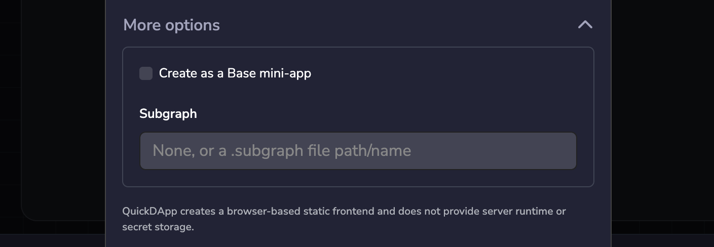

QuickDApp generates a static front end that runs in the browser. It has no server runtime or secret storage, so do not build features that rely on keeping API keys or other secrets private.

Click **Generate DApp** to start. The RemixAI chat then shows a short summary of the request rather than the full instructions sent to the AI. Click **Show request details** to see the full request.

RemixAI then writes the dApp's files, proposing each one for you to approve. You can approve them individually, or use **Approve All** to accept the whole set.

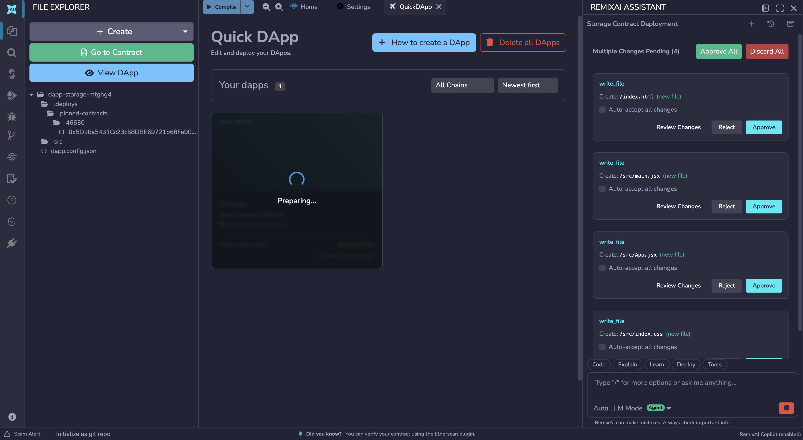

When generation finishes, the dApp opens in the QuickDApp tab with a live preview of the generated UI.

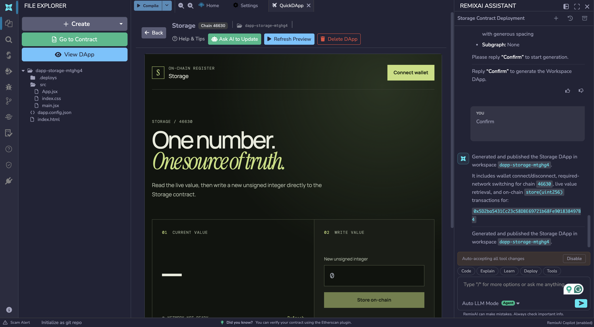

From here you can click **View DApp** to open it, **Refresh Preview** to rebuild the preview, **Go to Contract** to jump back to the contract it was generated from (the Primary Contract, if the dApp uses more than one), or **Ask AI to Update** to change the result. **Delete DApp** removes the generated dApp, and **Publish** publishes it to IPFS (see Publishing your dApp below).

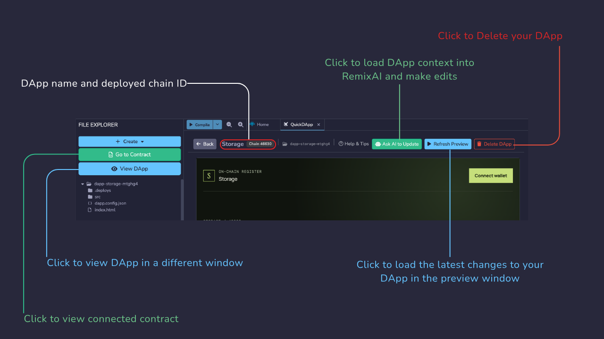

On Remix Desktop, the preview connects to your wallet through Browser Wallet. Select and connect Browser Wallet in Deploy and Run first; if you have not, the preview shows a message telling you to.

While QuickDApp is generating, updating, or publishing a dApp, it blocks actions that would conflict with the running operation, such as switching workspaces, deleting the dApp, or starting another update or publish. Wait for the operation to finish before trying again.

### Creating a dApp from a `.subgraph` file

You can also generate a dApp from a Subgraph query rather than from a contract. In the File Explorer, right-click a `.subgraph` file and select **Create dApp from Subgraph Query**. See {doc}`Subgraphs in Remix </subgraph>` for the full flow.

### Creating a dApp from a ZK circuit

You can also generate a dApp from a ZK circuit rather than from a contract. The dApp generates proofs in the browser and verifies them.

- **Circom**: Once you have compiled your circuit and generated a proof, click **Create ZK DApp** at the bottom of the Circom plugin panel, below the **Generate Proof** button. See {doc}`Circom Compiler </circom>` for compiling circuits and generating proofs.
- **Noir**: Once you have compiled your Noir program, click **Create ZK DApp** in the Noir Compiler plugin panel. See {doc}`Noir Compiler </noir>`.

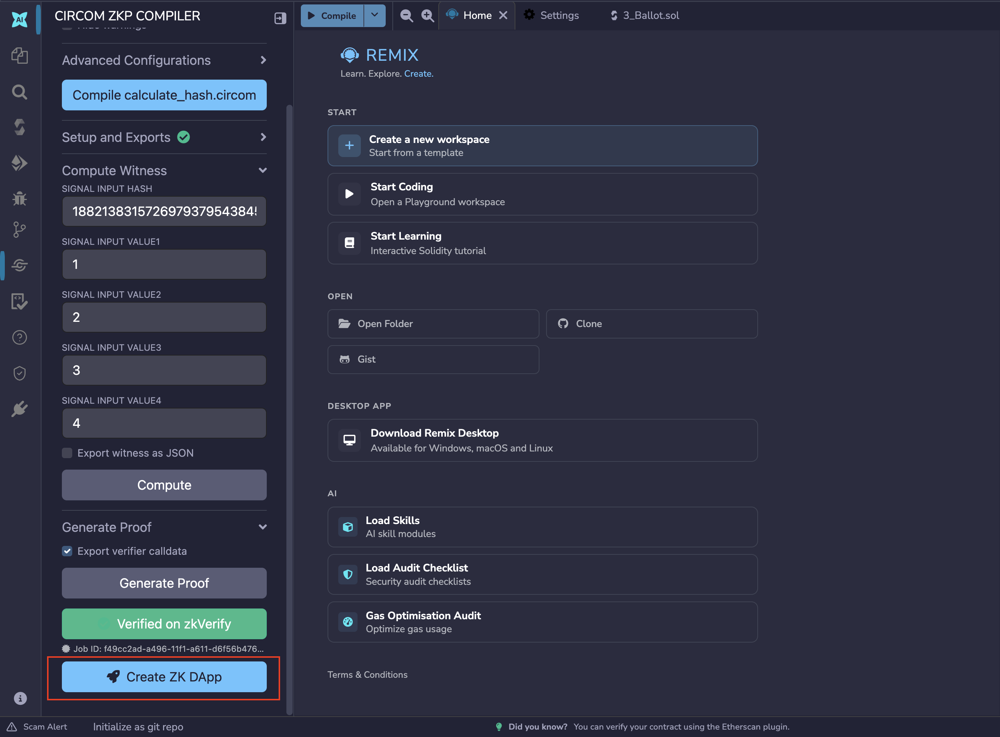

QuickDApp then asks how the dApp should verify proofs:

- **On-chain (verifier contract)**: Proofs are verified by a verifier contract you have already deployed. Select it from the list.
- **zkVerify (off-chain relay service)**: Proofs are sent to zkVerify instead of a contract. This needs a zkVerify (Kurier) API key, which you add in **Settings** > **Connected Services**.

From there, generation proceeds the same way as the other routes.

### Creating a dApp from inside another dApp's workspace

You do not have to leave a dApp's workspace to start a new one. While working in an existing dApp's workspace, you can write and deploy another contract, then create a dApp for it from Deploy and Run as usual.

QuickDApp creates the new dApp in a separate workspace of its own rather than inside the current dApp's files. **Go to Contract** in the new dApp takes you back to the workspace the contract was deployed from. QuickDApp does not track workspace renames, so if you rename either workspace, **Go to Contract** can stop working.

```{note}
Creating a dApp from inside another dApp's workspace only works in Remix on the web, with contracts deployed to a public network such as Sepolia. It is not available on the Remix VM, a local RPC network, or Remix Desktop.
```

## Using multiple contracts

A dApp is not limited to the single contract you generated it from. QuickDApp connects a dApp to its contracts through **contract bindings**: one **Primary Contract** plus up to 7 additional contracts, for a maximum of 8. Bindings only apply to dApps created from contracts, so dApps created from a Subgraph query or a Circom circuit do not have them.

Every contract in a dApp must be deployed on the same network. You can bind several Sepolia contracts together, for example, but you cannot mix a Sepolia contract with one deployed on another network.

### Selecting contracts when you create a dApp

When you create a dApp, the contract you started from becomes the Primary Contract. You can then bind up to 7 more from the contracts already deployed in Deploy and Run.

In the **Create DApp** modal, click **Add more contracts** to open the **Additional contracts** list, and check each contract you want to bind. The counter shows how many of the 7 slots you have used. Click **Done** to close the list; the Primary Contract card then shows how many additional contracts are bound.

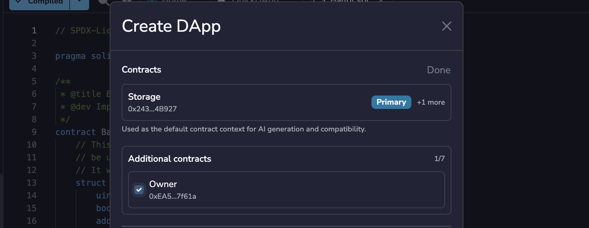

Decide which contract should be Primary before you start, because the Primary role cannot be moved to a different contract later. Only bind contracts the dApp needs, because bindings cannot be removed once the dApp is created.

### Adding or replacing a contract later

Click **Ask AI to Update** to open the **Update DApp** modal, and choose the kind of change you want:

- **UI or source only**: Changes the dApp's interface or code and keeps its current bindings.
- **Add a deployed contract**: Keeps the current bindings and adds another contract.
- **Replace a contract**: Swaps the contract behind one existing binding for a different deployment.

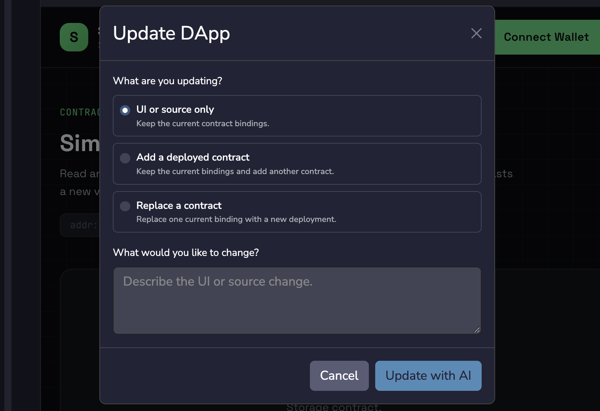

Adding a contract counts toward the limit of 8, so once a dApp has 8 bindings you can no longer add contracts, only replace existing ones.

Adding and replacing both work from contracts actually deployed in your current Deploy and Run environment, which must be on the same network as the dApp. If it is not, the change is blocked. The contract does not have to come from the dApp's own workspace; you can pick one from any other open workspace. The modal shows the dApp's network next to your current environment, and the contract you pick must be deployed on that same chain with a valid ABI and bytecode.

To add a contract, pick it under **Contract to add**, describe how the dApp should use it, and click **Update with AI**.

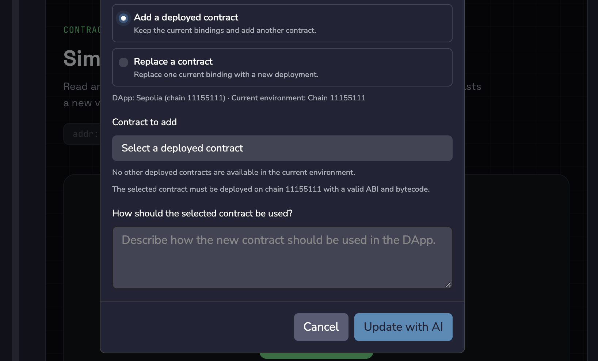

To replace one, pick the binding under **Contract to replace**, pick the new deployment under **Replacement contract**, describe what should change, and click **Update with AI**.

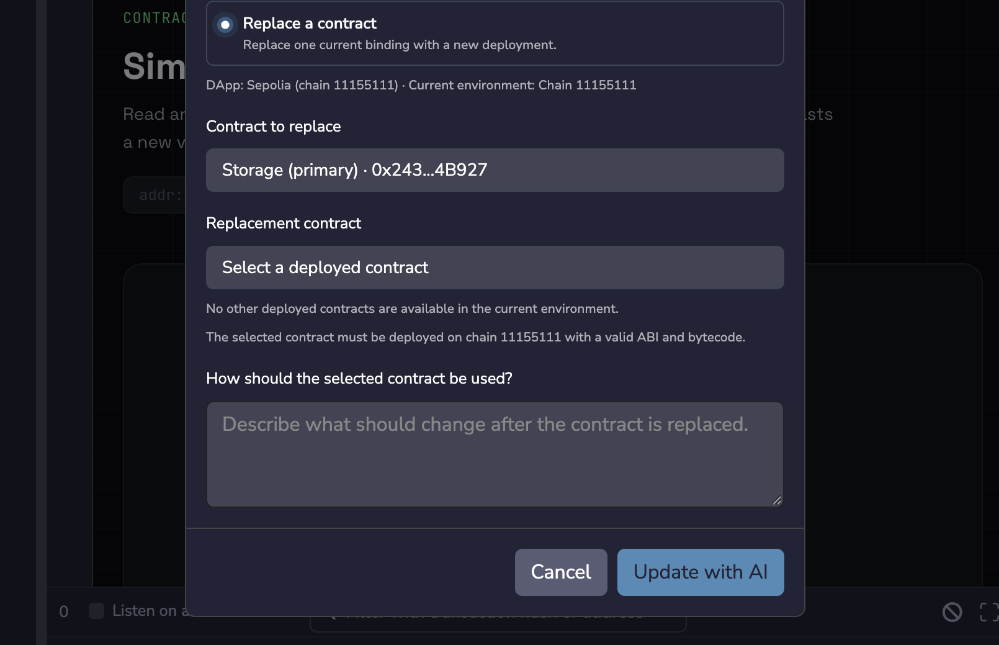

You always select the contract in the modal. RemixAI will not take a contract address from your chat message, so pasting an address into the conversation does not bind it.

```{warning}
You cannot add or replace contracts on a dApp built from Remix VM contracts. If you expect to change a dApp's contracts later, deploy them to a public network before creating it.
```

## Publishing your dApp

QuickDApp publishes your dApp's front end to IPFS. To publish, click **Publish** in the preview toolbar, or **Publish to IPFS** in the QuickDApp panel. Publishing is not available for dApps built on the Remix VM. See {doc}`Deploying a dApp </deploy_dapp>` for publishing and linking an ENS name.

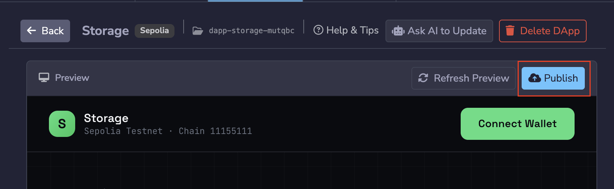

The QuickDApp tab shows which state the dApp is in:

- **Not published**: The dApp has never been published.
- **Published**: The published version matches your local files.
- **Published · Unpublished changes**: You changed the dApp after publishing it, for example with **Ask AI to Update**. The dApp keeps its existing IPFS CID until you publish again, which returns it to **Published**. While the dApp has unpublished changes, the **Publish** button reads **Publish changes**.
